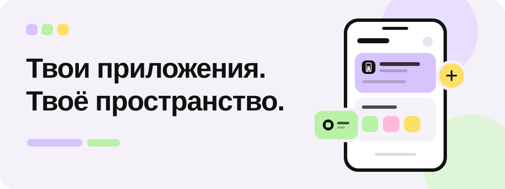
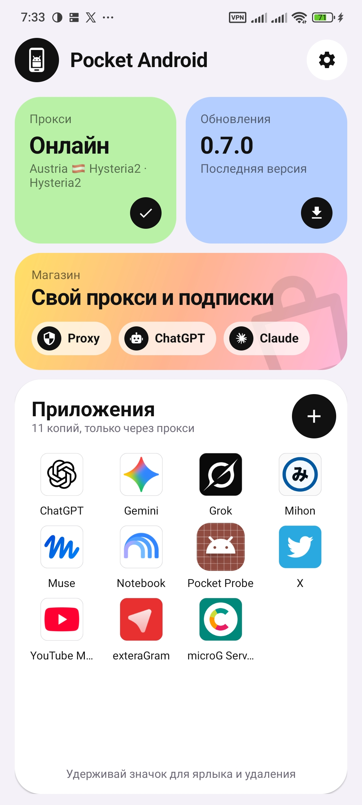
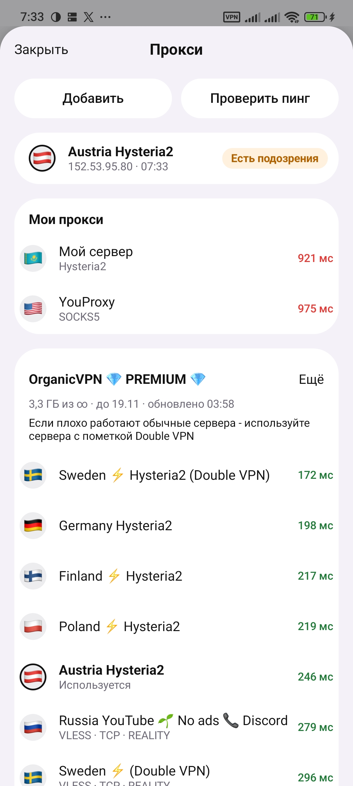
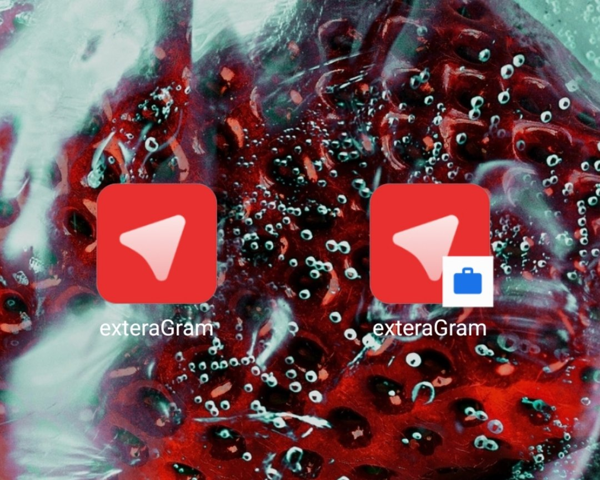

  

<h1 align="center">Pocket для Android</h1>

  Отдельное пространство для копий приложений 
  и твоё подключение для их работы в интернете.

  <a href="https://github.com/TheFactChain/pocket-android/releases/latest"><strong>Скачать Pocket</strong></a>
  · <a href="#установка">Установка</a>
  · <a href="#как-выглядит-pocket">Скриншоты</a>
  · <a href="#возможности">Возможности</a>
  · <a href="#как-это-работает">Как это работает</a>
  · <a href="#разработка">Разработка</a>

<strong>Android 10+</strong> · ARM64 и ARMv7 · открытый исходный код

  

## Что такое Pocket

Pocket создаёт рабочий профиль Android, в котором можно установить отдельные
копии приложений. У копий свои данные и свои учётные записи, а для выхода в
интернет можно выбрать собственный прокси. Личные приложения остаются в основном
профиле.

Например, можно держать вторую учётную запись мессенджера в Pocket, не выходя
из первой. Pocket — самостоятельная производная [Shelter](https://gitea.angry.im/PeterCxy/Shelter).

## Как выглядит Pocket

  
  &nbsp;&nbsp;
  

Главный экран и список подключений. Нажми на скриншот, чтобы открыть его в полном размере.

### Как отличить копию

На домашнем экране Android отмечает приложения рабочего профиля специальной
меткой. На примере ниже копия в Pocket находится справа и помечена значком
чемодана. Внешний вид метки может отличаться в зависимости от устройства и
лаунчера.

  

## Возможности

- **Копии приложений.** Устанавливай приложения в рабочий профиль, запускай их
  из Pocket и добавляй ярлыки на домашний экран.
- **Своё подключение.** Добавляй Hysteria 2 или VLESS + REALITY TCP по ссылке,
  QR-коду или из файла. Поддерживаются подписки и проверка пинга серверов.
- **Подключение для приложения.** Можно выбрать отдельный сервер для конкретной
  копии и проверить текущий внешний IP.
- **Восстановление настроек.** Подключения, подписки и настройки можно сохранить
  в файл с паролем и импортировать обратно.
- **Системный VPN рабочего профиля.** Pocket использует Android Always-on VPN и
  блокировку подключений без VPN для копий в профиле.

Для подключения нужен собственный сервер или подписка совместимого провайдера.
Pocket сам по себе не предоставляет бесплатный сервер.

## Установка

1. На телефоне с Android 10 или новее открой [последний выпуск Pocket](https://github.com/TheFactChain/pocket-android/releases/latest).
2. В разделе **Assets** скачай файл `Pocket-Android-<версия>.apk` и открой его.
   При необходимости разреши установку из источника, через который скачан файл.
3. Запусти Pocket и следуй системным шагам создания рабочего профиля. Android
   покажет, какие разрешения получает управляющее профилем приложение.
4. На главном экране нажми карточку **Прокси**, добавь и выбери своё подключение.
   Затем добавь нужные приложения в Pocket и запусти их копии.

Для работы нужен Android с поддержкой рабочих профилей. Возможность создания
профиля и поведение VPN зависят от устройства и прошивки; уже существующий
рабочий профиль, например корпоративный, может быть занят другой организацией.
Не удаляй его и его данные ради установки Pocket.

## Как это работает

Android хранит данные рабочих копий отдельно от данных личных приложений. При
этом установленная версия APK приложения общая для профилей: обновление самого
приложения может затронуть обе копии. Удаление рабочего профиля удаляет и данные
приложений внутри него.

Pocket настраивает VPN внутри рабочего профиля. Состояние политики и самого
подключения показываются отдельно: настроенная политика ещё не означает, что
соединение установлено. Пароли подключений хранятся локально с использованием
Android Keystore и AES-GCM.

В настройках можно отдельно включить прямые маршруты для российских сайтов или
правила провайдера. Эти исключения намеренно могут отправлять часть трафика в
обход прокси. DNS Pocket сейчас возвращает только IPv4-адреса; ресурсы,
доступные только по IPv6, через него недоступны.

Pocket находится в разработке. Работа функций, восстановление соединения и
блокировка трафика при сбоях требуют проверки на конкретном устройстве и в
конкретной сети. Сборка приложения сама по себе такой проверки не заменяет.

## Разработка

Исходный код открыт для изучения и доработки. Инструкция по подготовке среды,
сборке Android-приложения и локальной подписи находится в [руководстве по сборке](docs/building.md).
Сценарии испытаний на устройстве описаны в [проверках на телефоне](docs/device-checks.md).

Об ошибках и предложениях можно написать в [Issues](https://github.com/TheFactChain/pocket-android/issues).
Не прикладывай в открытые сообщения пароли, ссылки с ключами, личные данные или
файлы настроек.

## Лицензия и благодарности

Pocket основан на [Shelter](https://gitea.angry.im/PeterCxy/Shelter), созданном
PeterCxy и участниками проекта. Благодарим авторов и сохраняем их авторство.
Pocket распространяется на условиях [GNU GPL v3](LICENSE); сведения о сторонних
компонентах и их лицензиях собраны в [THIRD_PARTY_NOTICES.md](THIRD_PARTY_NOTICES.md).
